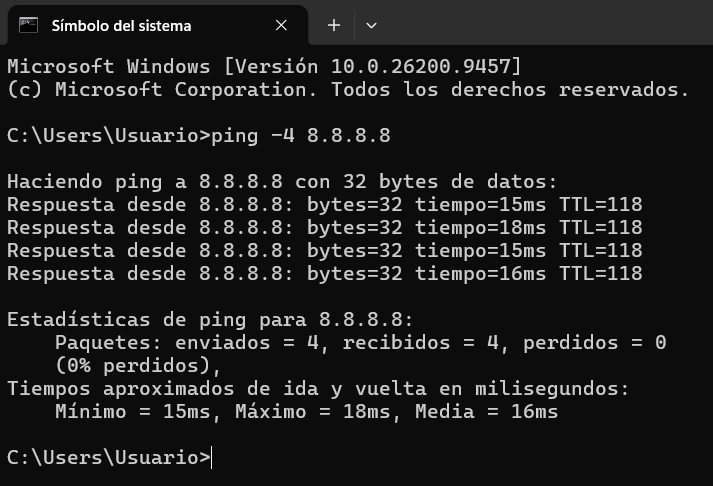
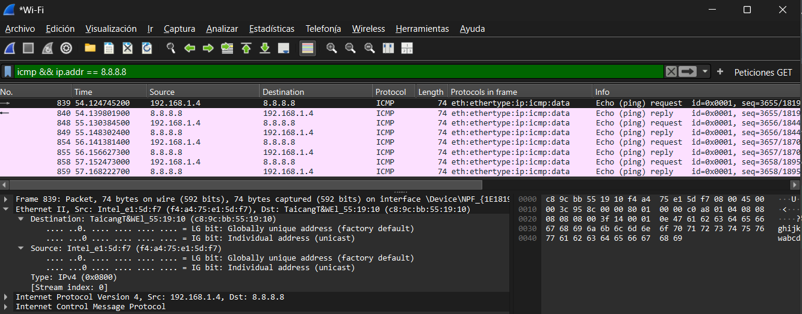
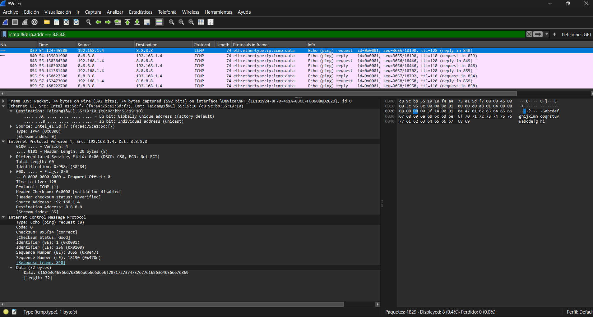
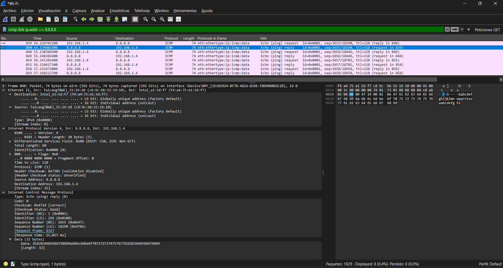
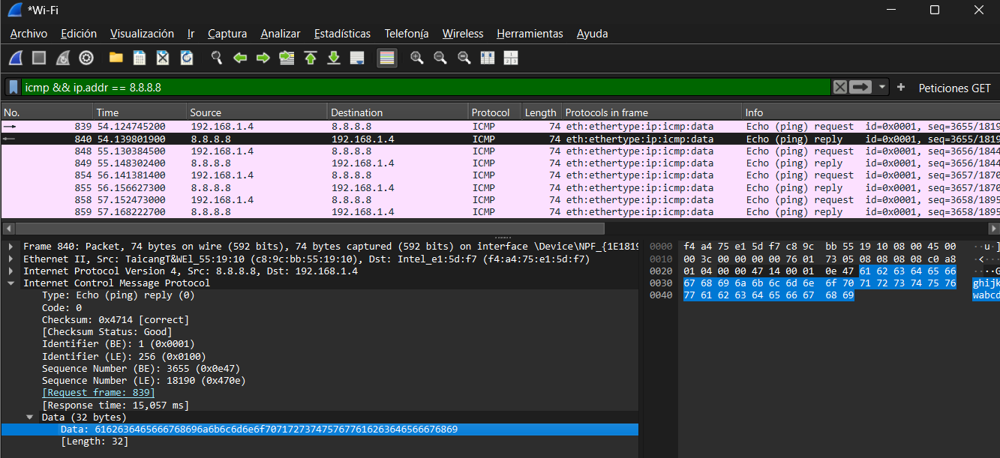
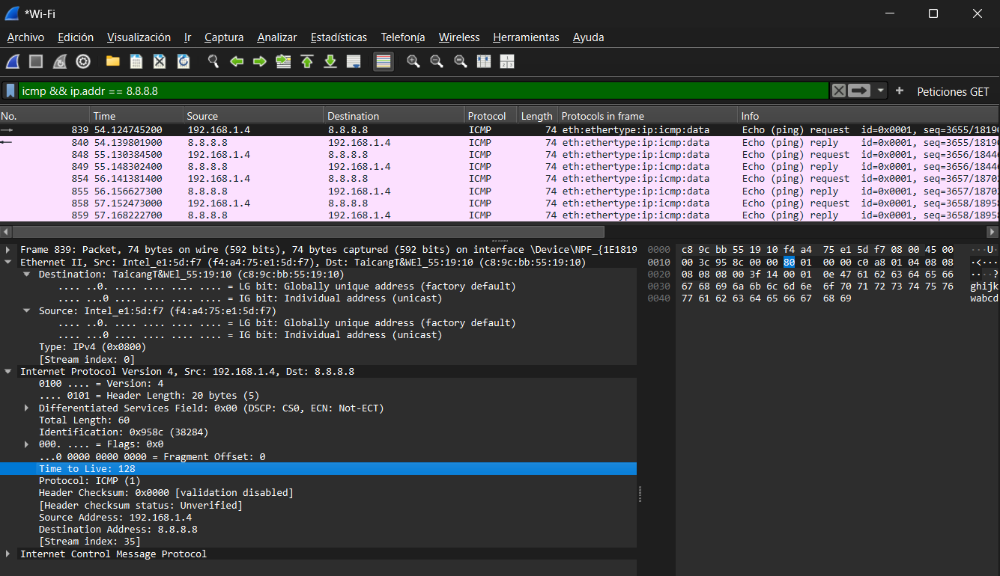
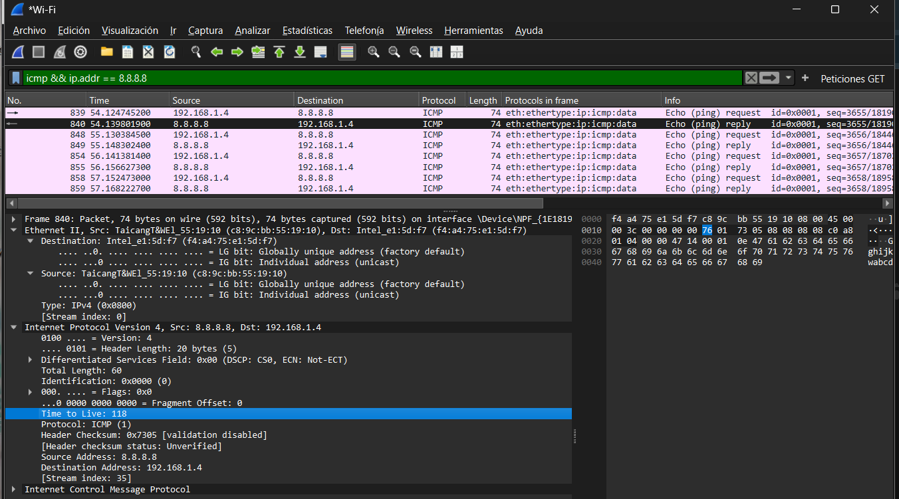
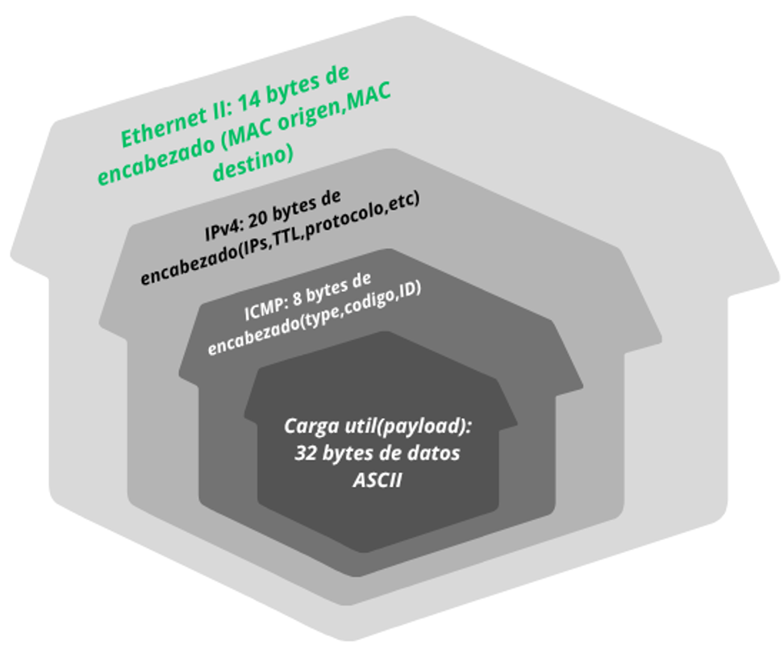

### **Terminal**

### **a) La MAC destino del Echo Request enviado a 8.8.8.8, ¿es la MAC de 8.8.8.8? ¿De qué equipo es? Compárenla con la MAC destino del ping al gateway. ¿Qué conclusión sacan sobre el alcance de una dirección MAC frente al de una dirección IP?**

En la imagen podemos notar que la dirección MAC de destino es `c8:9c:bb:55:19:10`.  
No es la MAC de 8.8.8.8 ,ya que la dirección registrada le pertenece al Gateway(router local).  
En comparación con el ping al gateway,tanto el ping al gateway y el ping a 8.8.8.8,la dirección MAC de destino es siempre la dirección del router del usuario.

Para concluir:
* **Dirección MAC:** Es física,permanente y única.Tiene alcance estrictamente local.Se encarga de indentificar de forma física a un dispositivo de red.Corresponde a la capa 2 o capa de enlace.
* **Dirección IP:** Es lógica,la asigna el router o proveedor de internet y puede cambiar dependiendo de la red a la que estoy conectado.Tiene un alcance global.Corresponde a la capa 3 o capa de red.

---

### **b) Comparen un Echo Request con su Echo Reply (Wireshark los vincula en el campo [Response frame:…]). Hagan una lista de los campos que cambian y de los que se mantienen en Ethernet, IP e ICMP. ¿Por qué tiene sentido cada cambio? ¿Por qué el identificador y el número de secuencia se mantienen?**

Al comparar el Echo request con el Echo reply se observan las siguientes diferencias:

**Campos que cambian:**
* **Capa Ethernet II:** Se invierten la MAC origen y la MAC destino (`f4:a4:75:e1:5d:f7` y `c8:9c:bb:55:19:10`).
* **Capa IPv4:** Se invierte la IP origen(`192.168.1.4`) con la IP destino(`8.8.8.8`).También varía el campo TTL ,pasa de 128 a 118. 
* **ICMP:** Cambia el campo type (Request es tipo 8 y Reply es tipo 0).

Las inversiones de direcciones MAC e IP son indispensables para que el paquete de respuesta pueda ser ruteado de regreso al emisor original.Por otro lado el ICMP cambia para avisarle al receptor que se trata de una Reply.

**Campos que NO cambian:**
* **Code:** Se mantiene en 0 en ambas tramas.
* **Identifier**
* **Sequence number**  

No cambian ya que sirve como un código de seguimiemto para las computadoras,es decir, sirve para identificar y vincular cada solicitud enviada con su respuesta recibida correspondiente.

  

---

### **c) ¿Dónde está el payload de ping? ¿Cuántos bytes tiene y qué contiene? ¿Es igual en el Reply? Si en el grupo hay una computadora con Windows y otra con Linux, compárenlos: ¿qué les sugiere que sean distintos?**

El payload del ping se encuentra al final del paquete ICMP,identificado en la sección data.  
En Windows ocupa 32 bytes de longitud y contiene la secuencia de caracteres ASCII de prueba (`abcde…`) y tanto en el Echo Reply como en el Echo Request ,el payload es exactamente los mismos 32 bytes.  
En comparación con Linux el payload cambia su tamaño ,en Linux el tamaño predeterminado es de 48 bytes.

  

---

### **d) ¿Qué valor de TTL tiene el Echo Request que ustedes enviaron? ¿Y el Reply que llegó de 8.8.8.8? ¿Por qué no son iguales? (Pista: investiguen qué hace un router con el TTL.)**

El Echo Request enviado salió con un TTL=128,mientras que el Echo Reply llegó con un TTL=118.  
No son iguales porque cada router por donde pasa el paquete decrementa en 1 unidad el valor del TTL para evitar que los paquetes circulen de manera indefinida en la red en caso de que haya bucles de enrutamiento.

  

---

### **e) Dibujen la encapsulación del paquete que eligieron como "cajas dentro de cajas", indicando para cada caja qué tamaño en bytes tiene según Wireshark.**

El tamaño total de la trama es de 74 bytes.  
Ecuación de verificación: **14B (Ethernet) + 20B (IPv4) + 8B (ICMP) + 32B (Payload) = 74 Bytes**

### **Tabla**
| Capa | Identificador origen | Identificador destino | ¿Qué campo indica qué protocolo viene "adentro"? |
| :--- | :--- | :--- | :--- |
| Ethernet II | f4:a4:75:e1:5d:f7 | c8:9c:bb:5519::10 | Type: IPv4 (0x0800) |
| IPv4 | 192.168.1.4 | 8.8.8.8 | Protocol: ICMP (1) |
| ICMP | Type: 8 (Echo request) / Identifier: 1 (0x0001) | Code: 0/ Sequence Number: 3651 | 32 bytes |
| Payload | 32 bytes de datos | | abcdefghijklmnopqrstuvwabcdefghi |