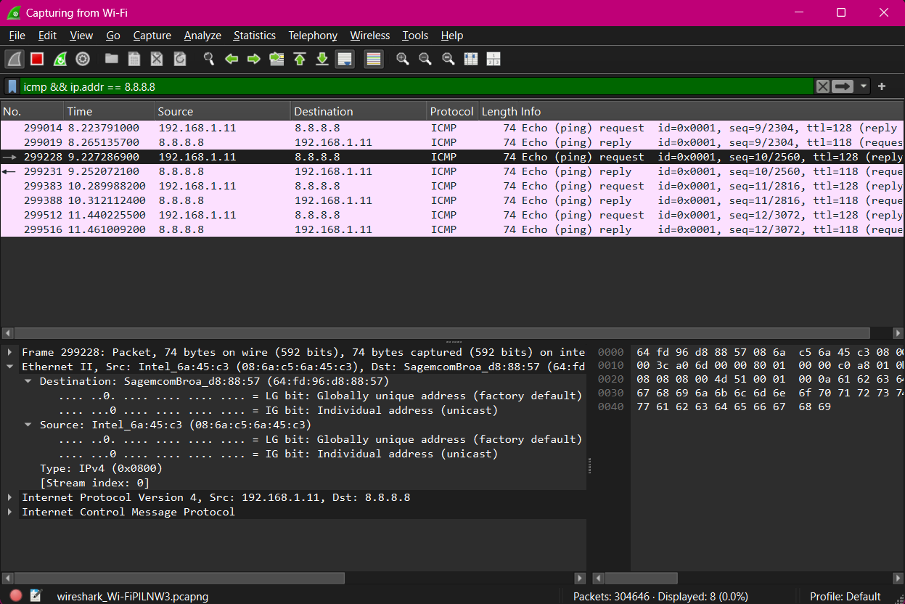
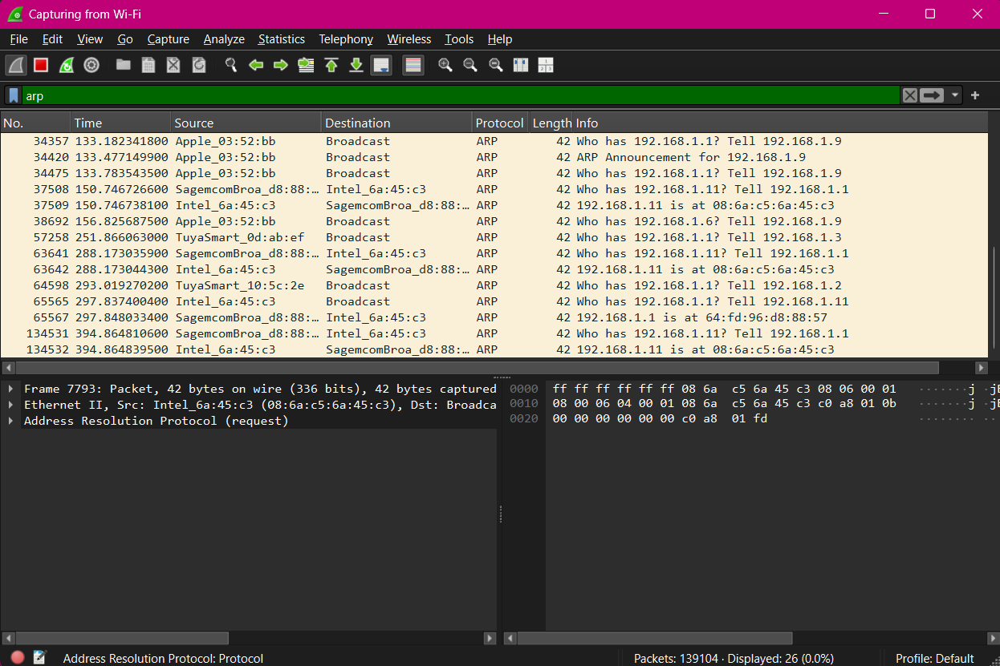
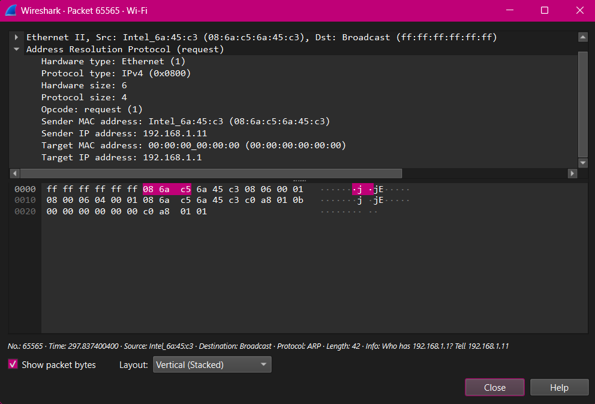
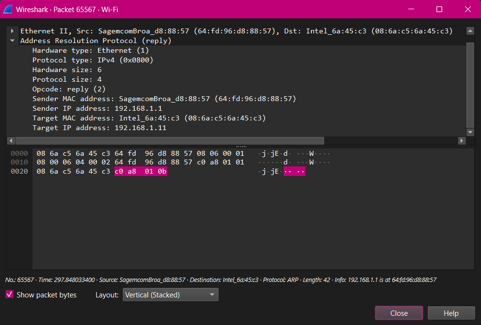

# Laboratorio 5

> **Asignatura:** Redes de Computadoras - Universidad Nacional de Córdoba (FCEFyN)
>
> **Integrantes:**
> - Baigorria, Ramiro Javier
> - Urrestarazu, Juan Ignacio 
> - Mena, Franco Grabiel 
> - Herrera, Mauricio Agustin
> - Ciruzzi, Martina
> - Montes, Franco Leonel 
> - Valla Tello, Desiderio Jesus 
>
> **Profesor:**
> - Santiago Martin Henn 

---

## Consigna 2
### ARP: de una IP a una dirección MAC

a) ¿Qué problema resuelve ARP? ¿En qué capa lo ubicarían y por qué es discutible?

ARP permite averiguar qué dirección MAC corresponde a una determinada dirección IPv4 dentro de una red local. 
Esto es necesario porque IP identifica lógicamente al host, pero para enviar una trama Ethernet dentro de la LAN se necesita una dirección 
MAC de destino. Es difícil ubicar ARP en una sola capa porque trabaja con direcciones IP, pero las relaciona con direcciones MAC.

b) ¿Qué es un ARP Request y un ARP Reply? ¿A quién se envía cada uno?

Un ARP Request es una consulta que pregunta qué dispositivo posee una determinada dirección IP. 
Se envía por broadcast dentro de la LAN porque el emisor todavía no conoce la MAC del destino. El ARP Reply es la respuesta del dispositivo 
que posee esa IP e informa su dirección MAC, normalmente se envía de forma unicast al equipo que hizo la consulta.

c) ¿Qué es la caché ARP y por qué existe?

La caché ARP es una tabla que guarda temporalmente asociaciones entre direcciones IPv4 y direcciones MAC que el equipo ya aprendió, y existe para evitar tener que hacer un ARP Request cada vez que se necesita enviar una trama al mismo dispositivo, lo que permite reducir tráfico 
innecesario.

d) “Tengo la IP de una máquina de mi red local. ¿Cómo sé a qué dirección MAC debo enviarle la trama?”

Primero el equipo consulta su caché ARP. Si ya existe una asociación para esa IP, utiliza directamente la MAC almacenada, si no existe, 
envía un ARP Request por broadcast preguntando quién tiene esa IP. El equipo correspondiente responde con un ARP Reply indicando su 
dirección MAC y esa asociación se guarda temporalmente en la caché.

e) Ver la caché ARP de su computadora y buscar la entrada del gateway:

Al consultar la caché ARP con arp -a se observó que la puerta de enlace predeterminada 192.168.1.1 está asociada a la dirección MAC 64:fd:96:d8:88:57.
Al analizar en Wireshark un ICMP Echo Request enviado a 8.8.8.8, la MAC destino de la trama Ethernet también fue 64:fd:96:d8:88:57. Por lo tanto coinciden. Esto se da porque aunque la dirección IP destino sea 8.8.8.8, al estar fuera de la red local la trama Ethernet se envía al gateway como siguiente salto.

f) Generar tráfico ARP y capturarlo. Capturen en la interfaz Wi-Fi/Ethernet con el filtro arp.

Se generó tráfico ARP haciendo ping a una dirección IP de la misma
subred que no figuraba en la caché ARP (192.168.1.253).

En Wireshark, utilizando el filtro arp, se observaron varios ARP Request
enviados desde 192.168.1.11 a broadcast consultando por la dirección
192.168.1.253. No se recibió ningún ARP Reply.

### Análisis de ARP Request y ARP Reply

| Campo | ARP Request | ARP Reply |
|---|---|---|
| MAC destino (Ethernet) | ff:ff:ff:ff:ff:ff | 08:6a:c5:6a:45:c3 |
| MAC origen (Ethernet) | 08:6a:c5:6a:45:c3 | 64:fd:96:d8:88:57 |
| Opcode | 1 (Request) | 2 (Reply) |
| Sender MAC address | 08:6a:c5:6a:45:c3 | 64:fd:96:d8:88:57 |
| Sender IP address | 192.168.1.11 | 192.168.1.1 |
| Target MAC address | 00:00:00:00:00:00 | 08:6a:c5:6a:45:c3 |
| Target IP address | 192.168.1.1 | 192.168.1.11 |

a) ¿Por qué el Request va a broadcast y el Reply no? ¿Qué valor tiene Target MAC address en el Request y por qué?

El ARP Request se envía a broadcast (ff:ff:ff:ff:ff:ff) porque el emisor todavía no conoce la dirección MAC asociada a la IP 192.168.1.1. Entonces dentro del mensaje ARP, el campo Target MAC address tiene el valor 00:00:00:00:00:00.
El ARP Reply, en cambio, se envía directamente a la MAC del equipo que hizo la consulta (08:6a:c5:6a:45:c3) porque el router ya conoce quién realizó el Request.

b) En el encabezado Ethernet de la trama ARP, ¿qué valor tiene el campo Type? ¿Hay un encabezado IP? ¿Qué les dice eso sobre dónde "vive" ARP? 

En el encabezado Ethernet el campo Type tiene el valor 0x0806, que identifica al protocolo ARP. No hay un encabezado IP entre Ethernet y ARP, lo que muestra que ARP se transporta directamente dentro de una trama Ethernet y no dentro de un paquete IP. Por esto no queda tan claro ubicarlo en una sola capa: usa direcciones IPv4 pero se transmite directamente sobre Ethernet.

c) Con la Opción A (IP inexistente): ¿cuántos ARP Request aparecieron? ¿Hubo Reply? ¿Apareció algún
ICMP Echo Request en la captura? Expliquen por qué.

Al hacer ping a la IP inexistente 192.168.1.253 se observaron 6 ARP Request enviados por 192.168.1.11 a broadcast y no se recibió ningún ARP Reply. Al ver conjuntamente arp || icmp tampoco apareció ningún ICMP Echo Request hacia esa dirección. Esto pasa porque antes de enviar el paquete IP dentro de una trama Ethernet el host necesita conocer la MAC del destino. Como nadie respondió al ARP, no pudo formar la trama y el Echo Request no llegó a enviarse.

d) Volvieron a hacer ping al mismo destino un minuto después: ¿apareció ARP de nuevo? Revisen la caché
ARP. ¿Qué ventaja tiene la caché y qué problema podría causar si una entrada quedara vieja?

Al volver a hacer ping a 192.168.1.253 aparecieron nuevamente ARP Request en Wireshark. No se recibió ningún ARP Reply y la dirección 192.168.1.253 tampoco apareció en la caché ARP, ya que no se pudo resolver una dirección MAC asociada.
La caché ARP permite guardar temporalmente las asociaciones IP–MAC ya aprendidas, evitando tener que realizar un nuevo ARP Request cada vez que se quiere enviar tráfico al mismo dispositivo. Si una entrada queda desactualizada el host podría enviar las tramas a una dirección MAC incorrecta hasta que esta entrada venza o sea actualizada.
