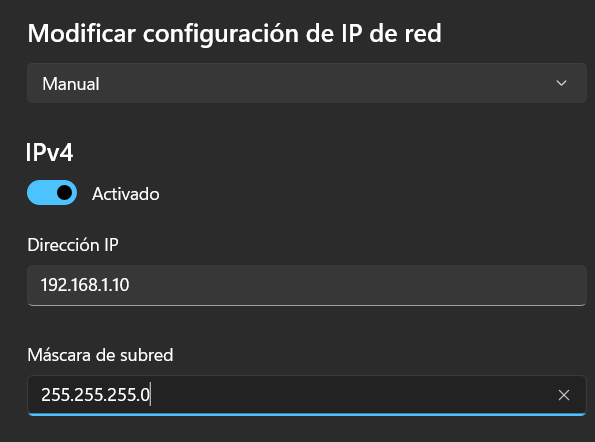
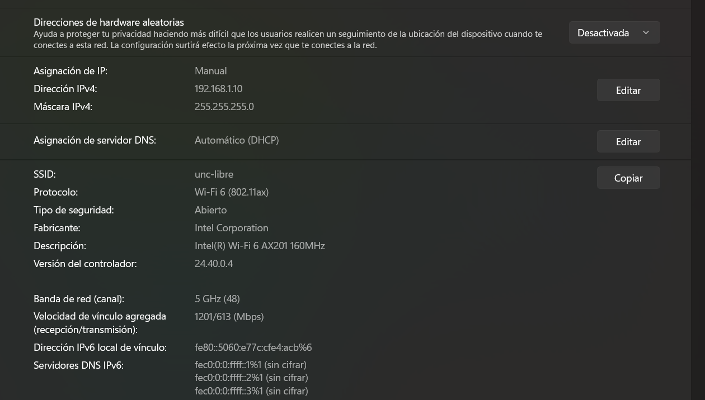
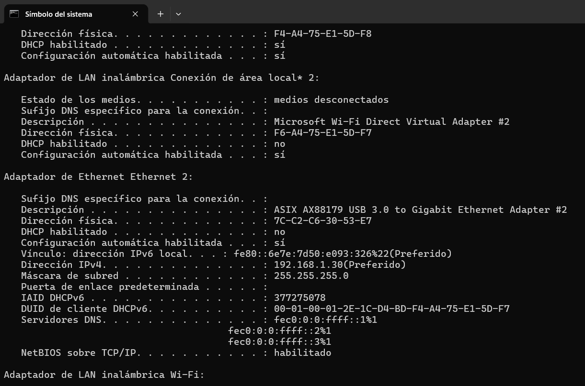
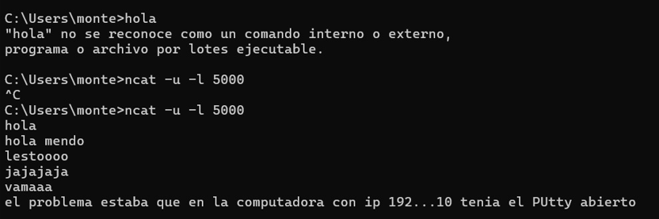

# Levantar y testear una LAN
**1-Configuración manual de las interfaces de red**

Utilizamos un total de 3 computadoras asi todos los compañeros podian participar de la actividad.A cada una se le modificaron los parámetros de red de la siguiente manera:

* Computadora emisora: 192.168.1.30
* Computadora receptora: 192.168.1.10
* Tercera computadora: 192.168.1.20
* Mascara de subred: 255.255.255.0

A continuacion adjuntamos la configuración de la IPv4

Es importante aclarar que al estar las 2 computadoras en la misma red,no hizo falta configurar la puerta de enlace(gateway) ya que el trafico era local y no era necesario salir a otra red o hacia internet.

Las IP elegidas tuvieron sentido ya que permitieron establecer a ambas direcciones IP en una misma red local para poder comunicarse directamente a través del switch.

**2-Conexion al switch e intercambio de paquetes**

Una vez realizados los cambios pasamos a la segunda etapa de conectar las computadoras al switch.
Se verificó desde la computadora emisora que los paquetes lleguen correctamente.

*Computadora emisora*

*Computadora receptora*

Utilizando el wireshark pudimos capturar los paquetes recibidos.

.jpeg)

A partir de la captura podemos obtener los siguientes datos:
* **Protocolo:** **UDP** (*User Datagram Protocol*).

* **Direcciones MAC (Capa 2):** La interfaz de origen corresponde a `7c:c2:c6:30:53:e7`  y la de destino a `00:50:b6:24:5c:32`.

* **Puerto Origen:** `58160` (puerto  asignado aleatoriamente por el sistema operativo emisor).

* **Puerto Destino:** `5000` (puerto de escucha en el receptor configurado con `ncat`).

* **Filtro de Captura:** En la barra superior de Wireshark se aplicó el filtro `udp.port == 5000`, lo que permitió aislar exclusivamente el tráfico UDP generado hacia ese puerto.

* **Carga util:** 6 bytes 
* **Contenido del mensaje(ASCII):** En el panel inferior derecho de volcado hexadecimal y ASCII, se lee el texto transmitido: **hola**

**3-Preguntas**

*a) ¿Se observa algún procedimiento de establecimiento de conexión antes de enviar los datos?*

No se observa ningun procedimiento previo.UDP no avisa ni pide permiso antes de transmitir. En la captura de Wireshark vemos que el primer paquete que salió ya contenía el texto que escribimos.El protocolo envía los datos de manera directa.

*b) ¿Existe algún mecanismo de confirmación de recepción equivalente a los ACK de TCP?*

No existe ningún mecanismo de confirmación.El protocolo UDP envía los datos y no espera respuesta.La computadora receptora recibe los mensajes, pero no envía ningún aviso de "recibido" (*ACK*) de vuelta al emisor.
Este protocolo es ideal para transmisiones rapidas y simples.

*c) ¿Qué ocurre si se envían mensajes mientras el receptor UDP no está ejecutándose?*

El mensaje sale de todas formas, pero la computadora de destino lo rechaza porque no tiene ningún programa abierto en ese puerto.
Esa computadora responde con un mensaje de error (`ICMP Port Unreachable`), y por eso la consola de `ncat` se corta avisándonos que la conexión falló.

*d) ¿UDP garantiza que los mensajes lleguen en el mismo orden en que fueron enviados?*

No garantiza.Cada datagrama UDP viaja como un paquete independiente y no contiene números de secuencia en su cabecera.Si la red entrega los paquetes desordenados o alguno se pierde en el camino,UDP no los reordena ni solicita su retransmisión.
En este caso los paquetes llegaron en orden debido a la cantidad de computadoras conectadas al switch y que la cantidad de mensajes enviados no era volumetrica,permitiendo una llegada secuencial.

*e) ¿Qué aplicaciones reales utilizan UDP y por qué?*

Se usa en juegos en línea,llamadas por Internet (VoIP), transmisiones en vivo (streaming) y consultas DNS.Se prefiere UDP porque importa la velocidad y no tener demoras,siendo mejor perder un paquete aislado que congelar la pantalla o pausar el audio esperando a que se retransmita.

##

Antes de ponernos a realizar las conexiones oficiales,quisimos hacer algunas pruebas
Adjuntamos la imagen del CMD de la computadora con IP 192.168.1.10 cuando era la emisora haciendo ping a la computadora receptora con IP 192.168.1.20

