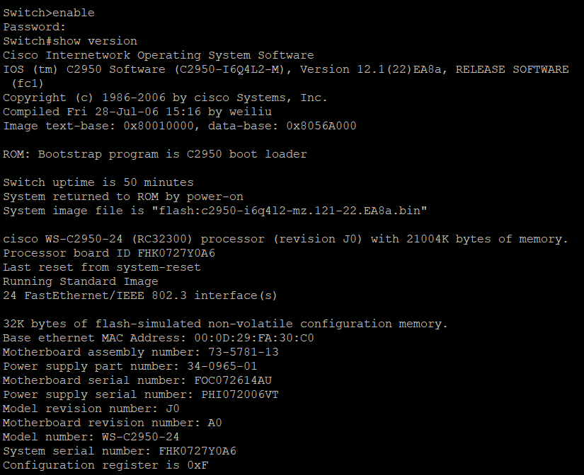
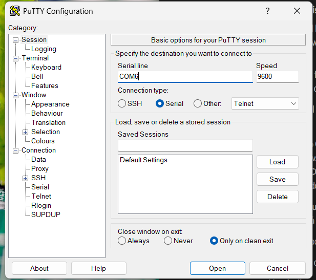
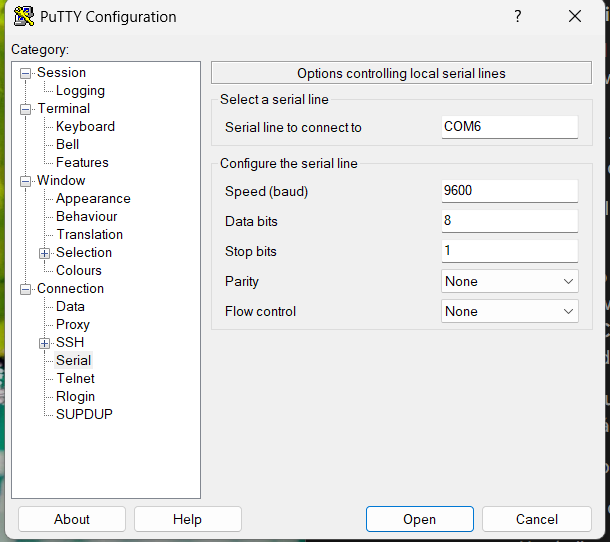
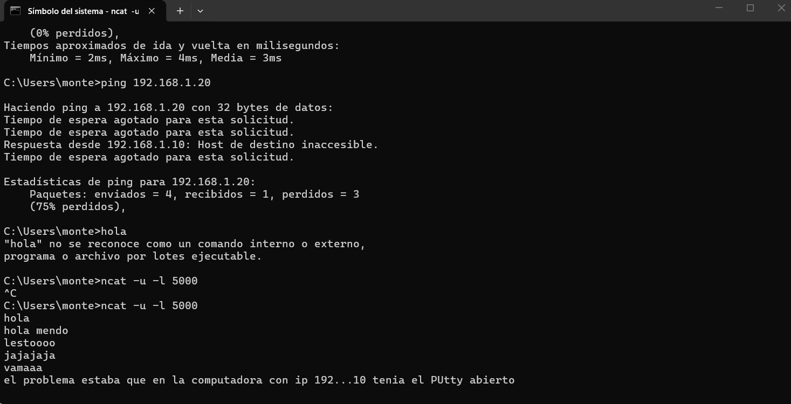
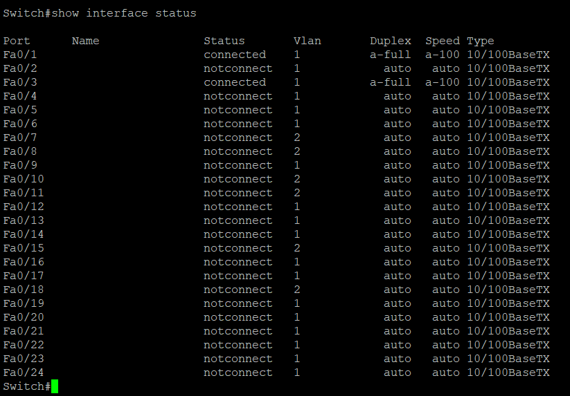
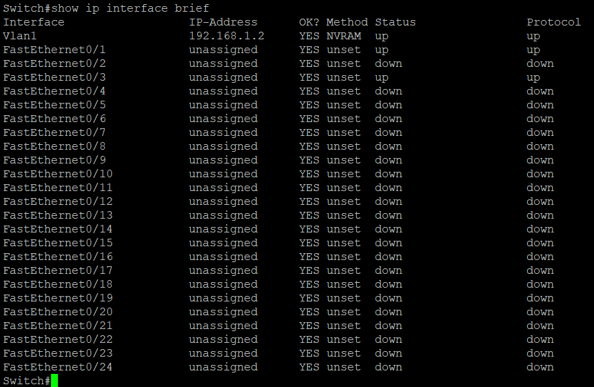
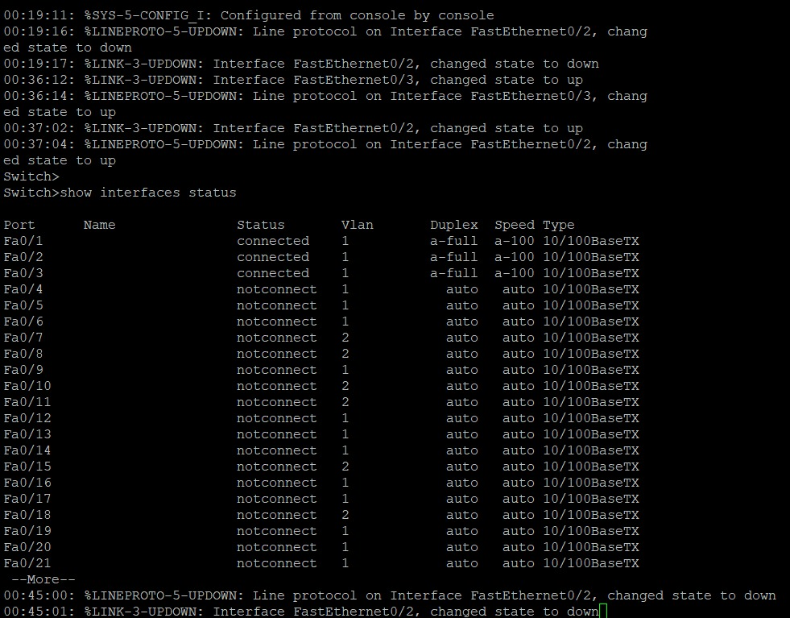

# Opcional – Switch Cisco Catalyst 2950

## 1) Características principales del switch

### Identificación del equipo del laboratorio

Antes de buscar el datasheet, identificamos el modelo exacto conectándonos por consola y ejecutando `show version`. El equipo es un **Cisco Catalyst WS-C2950-24**, el modelo base de la serie 2950 con 24 puertos Fast Ethernet y sin uplinks Gigabit.



De la salida de `show version` obtuvimos estos datos de la unidad:

* **Modelo:** WS-C2950-24, revisión J0.
* **Sistema operativo:** Cisco IOS 12.1(22)EA8a, imagen `C2950-I6Q4L2-M` (*Standard Image*, la imagen básica de la serie).
* **Procesador:** RC32300, con 21004K bytes de memoria.
* **Interfaces:** 24 FastEthernet/IEEE 802.3.
* **NVRAM:** 32K, donde se guarda la configuración de arranque (*startup-config*).
* **MAC base:** `00:0D:29:FA:30:C0`.
* **Registro de configuración:** 0xF.

### Datos del datasheet

Los valores siguientes corresponden a la hoja de datos original de los modelos 2950-12 y 2950-24. Los modelos 2950G, 2950T y 2950C tienen cifras distintas porque agregan uplinks Gigabit o de fibra.

| Característica | Valor |
|---|---|
| Puertos | 24 × 10BaseT/100BaseTX autosensing (RJ-45) |
| Matriz de conmutación (*switching fabric*) | 8,8 Gbps |
| Ancho de banda máximo de reenvío | 4,4 Gbps |
| Tasa de reenvío (paquetes de 64 bytes) | 3,6 Mpps a velocidad de línea (*wire-speed*) |
| Buffer de paquetes | 8 MB compartidos entre todos los puertos |
| DRAM / Flash | 16 MB / 8 MB |
| Tabla de direcciones MAC | hasta 8.000 direcciones |
| VLANs | 64 VLANs por switch |
| Spanning Tree | 64 instancias (PVST+) |
| Puerto de consola | RJ-45 de 8 pines (gestión fuera de banda) |
| Formato | 1 unidad de rack (1 RU) |
| Dimensiones (Al × An × Prof) | 4,36 × 44,45 × 24,18 cm |
| Peso | 3,0 kg |
| Alimentación | fuente interna autorango de 100–127 / 200–240 VAC, 50–60 Hz. Admite fuente redundante externa Cisco RPS 300 |
| Consumo máximo | 30 W (102 BTU/h) |
| MTBF (WS-C2950-24) | 268.292 horas |
| Temperatura de operación | −5 °C a 45 °C |
| Humedad de operación | 10 % a 95 % sin condensación |

### Estándares soportados

* IEEE 802.3 (10BaseT) e IEEE 802.3u (100BaseTX).
* IEEE 802.3x (*full duplex* y control de flujo).
* IEEE 802.1D (*Spanning Tree Protocol*).
* IEEE 802.1Q (VLANs con etiquetado de tramas).
* IEEE 802.1p (prioridad de clase de servicio, CoS).

### Funciones destacadas

* **Autonegociación:** cada puerto detecta solo la velocidad (10/100 Mbps) y el modo dúplex (*half/full*). Por eso en `show interfaces status` aparecen como `a-full` y `a-100`.
* **Calidad de servicio (QoS):** cuatro colas de salida por puerto en hardware, con planificación WRR (*Weighted Round Robin*) y prioridad estricta para tráfico sensible como voz. Las tramas pueden reclasificarse según el CoS 802.1p o un CoS por defecto del puerto.
* **EtherChannel:** permite agrupar varios enlaces Fast Ethernet entre switches, routers o servidores para sumar ancho de banda.
* **CDP (*Cisco Discovery Protocol*):** permite que las estaciones de gestión descubran el switch dentro de la topología.
* **Control de tormentas de *broadcast*:** se configura por puerto.
* **Gestión:**
  * CLI por consola (fuera de banda) y por Telnet (en banda).
  * SNMP y agente RMON embebido con los grupos History, Statistics, Alarms y Events.
  * Cisco CMS (*Cluster Management Suite*): administra hasta 16 switches interconectados desde un navegador web usando una sola dirección IP.

**Cableado:** para 10BaseT sirve UTP categoría 3, 4 o 5, y para 100BaseTX se necesita UTP categoría 5. Por eso los cables Cat5/Cat5e que armamos en la Parte 1 sirven para conectar las PCs a este switch.

**Indicadores (LEDs):** cada puerto tiene un LED que indica enlace, puerto deshabilitado, actividad, velocidad y *full duplex*. El panel frontal tiene además LEDs de estado del sistema, de la fuente redundante (RPS) y de utilización de ancho de banda.

---

## 2) Checklists de procedimientos

Estos checklists describen los procedimientos que seguimos en el laboratorio con el switch Cisco Catalyst WS-C2950-24. Cada uno incluye los pasos y, al final, lo que registramos durante la práctica.

### a) Conexión de una PC al puerto de consola del switch a 9600 baudios con PuTTY

**Elementos utilizados**

- [ ] Switch Cisco Catalyst WS-C2950-24 del laboratorio.
- [ ] Cable serie a RJ-45 (Fig. 2 de la consigna).
- [ ] Adaptador serie a USB (Fig. 2 de la consigna).
- [ ] PC con Windows y PuTTY instalado.

**Procedimiento**

- [ ] **1.** Conectar el extremo RJ-45 del cable al puerto de consola (*CONSOLE*) del switch.
- [ ] **2.** Conectar el extremo serie del cable al adaptador serie a USB y el adaptador a un puerto USB de la PC.
- [ ] **3.** Identificar el puerto COM que Windows le asignó al adaptador, en *Administrador de dispositivos → Puertos (COM y LPT)*. En nuestra PC el adaptador quedó como **COM6**.
- [ ] **4.** Abrir PuTTY y, en la categoría **Session**, seleccionar *Connection type:* **Serial**, *Serial line:* **COM6** y *Speed:* **9600**.

  

- [ ] **5.** En **Connection → Serial**, verificar los parámetros de la línea: 9600 baudios, 8 bits de datos (*Data bits*), 1 bit de parada (*Stop bits*), sin paridad (*Parity: None*) y sin control de flujo (*Flow control: None*).

  

- [ ] **6.** Presionar **Open** y luego **Enter** para que el switch muestre el prompt.
- [ ] **7.** Verificar el acceso: la consola tiene que mostrar el prompt `Switch>`. Desde ahí ejecutamos `enable` (el switch pide contraseña) y `show version`. Su salida confirmó el modelo del equipo y la versión de IOS (ver la captura de la sección 1).

**Turnos entre integrantes**

- [ ] **1.** Quien termina su verificación cierra la sesión de PuTTY.
- [ ] **2.** Se pasa el cable de consola con el adaptador a la PC del siguiente integrante.
- [ ] **3.** El siguiente integrante repite los pasos 2 a 7. En el paso 3 hay que volver a revisar el número de COM, porque Windows lo asigna en cada PC.
- [ ] **4.** El acceso queda verificado cuando aparece el prompt `Switch>`.

Todos los integrantes del grupo verificamos el acceso a la consola del switch siguiendo estos pasos.

**Observación**

Durante la práctica, la PC con IP 192.168.1.10 no lograba comunicarse con la 192.168.1.20. El `ping` perdió el 75 % de los paquetes y la propia PC respondió "Host de destino inaccesible". El grupo detectó que el problema era que esa computadora tenía PuTTY abierto. Una vez resuelto, la PC recibió sin problemas los mensajes UDP enviados con `ncat`. Por eso, en el paso 1 de los turnos, cada integrante cierra la sesión de PuTTY antes de pasar el cable.



### b) Acceso a la administración del switch y habilitación de interfaces

**Modos de la CLI de Cisco IOS que se usan**

| Prompt | Modo | Cómo se accede |
|---|---|---|
| `Switch>` | EXEC de usuario | Es el prompt que aparece al abrir la consola |
| `Switch#` | EXEC privilegiado | Con `enable` y la contraseña del switch |
| `Switch(config)#` | Configuración global | Con `configure terminal` desde el modo privilegiado |
| `Switch(config-if)#` | Configuración de interfaz | Con `interface fastEthernet 0/x` desde la configuración global |

**Procedimiento**

- [ ] **1.** Con la sesión de consola abierta (checklist a), pasar al modo privilegiado con `enable` e ingresar la contraseña.
- [ ] **2.** Relevar el estado de las interfaces antes de modificar nada:
  ```
  Switch# show interfaces status
  Switch# show ip interface brief
  ```
- [ ] **3.** Elegir los puertos que se van a usar. Tienen que estar en la misma VLAN que los demás equipos de la práctica.
- [ ] **4.** Entrar al modo de configuración y habilitar cada interfaz elegida:
  ```
  Switch# configure terminal
  Switch(config)# interface fastEthernet 0/x
  Switch(config-if)# no shutdown
  Switch(config-if)# end
  ```
- [ ] **5.** Conectar las PCs al switch con los cables armados en la Parte 1. En la consola deben aparecer los mensajes `%LINK-3-UPDOWN`, que indica el estado del enlace físico, y `%LINEPROTO-5-UPDOWN`, que indica el estado del protocolo de línea, ambos con el cambio a *up*.
- [ ] **6.** Confirmar con `show interfaces status` que los puertos usados figuran como `connected`.
- [ ] **7.** No guardar la configuración salvo que sea necesario. Los cambios hechos quedan en la *running-config* y se pierden al reiniciar el switch. Para guardarlos se usa `copy running-config startup-config`.

**Registro del trabajo realizado**

*Estado inicial de las interfaces.* Con `show interface status` vimos que Fa0/1 y Fa0/3 estaban en estado `connected`, autonegociados a 100 Mbps *full duplex* (`a-full`, `a-100`), y que el resto de los puertos estaba en `notconnect`. La mayoría de los puertos pertenecía a la VLAN 1, salvo Fa0/7, Fa0/8, Fa0/10, Fa0/11, Fa0/15 y Fa0/18, que estaban en la VLAN 2.



*Direccionamiento.* Con `show ip interface brief` vimos que la interfaz de administración Vlan1 tenía la dirección 192.168.1.2. Esa dirección estaba cargada desde la NVRAM (método `NVRAM`), o sea desde la configuración guardada del switch, y pertenece a la misma subred que las PCs de la práctica (192.168.1.0/24). Fa0/1 y Fa0/3 figuraban en estado `up/up`, y el resto en `down/down`.



*Cambios de estado registrados en la consola.* El switch fue registrando estos eventos en la consola:

* **00:19:11:** `%SYS-5-CONFIG_I: Configured from console by console`. Indica que se aplicaron cambios de configuración desde la consola.
* **00:19:16 a 00:19:17:** Fa0/2 pasa a *down*.
* **00:36:12 a 00:36:14:** Fa0/3 pasa a *up*.
* **00:37:02 a 00:37:04:** Fa0/2 pasa a *up*.

Después de esos eventos, `show interfaces status` mostró los puertos **Fa0/1, Fa0/2 y Fa0/3 en estado `connected`**, en la VLAN 1 y a 100 Mbps *full duplex*. Esas fueron las interfaces que quedaron levantadas para usar en el laboratorio. Más tarde, a las 00:45:00, Fa0/2 volvió a pasar a *down*.


