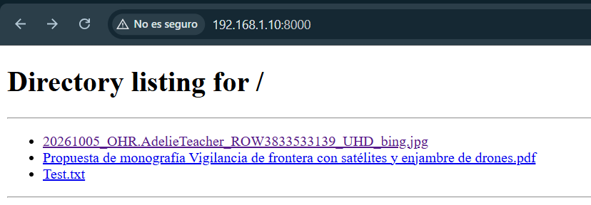
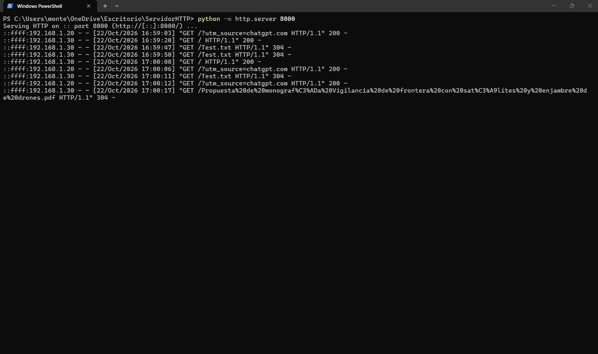
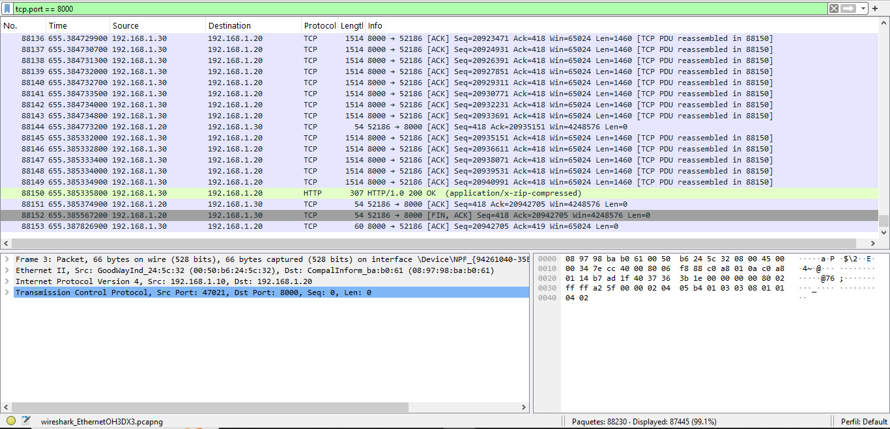

## Desarrollo de un pequeño servidor 

Desarrollamos un servidor HTTP en una red de área local (LAN) usando un switch cisco en la facultad. el objetivo de esta tarea era crear un pequeño server de cual podiamos descargar los archivos y de paso analizar el trafico.

## 1. ¿Como implementamos el servidor HTTP?

Utilizamos una de nuestras computadoras que estaban conectada a la LAN con dirección IPv4 `192.168.1.10`, configurada como servidor HTTP.

Luego creamos una carpeta/directorio denominada `ServidorHTTP`, que contenía tres archivos de diferentes formatos:

- Un archivo de texto (`Test.txt`).
- Un documento PDF.
- Una imagen JPG.


*Imagen del servidor con sus archivos correspondientes*

Desde PowerShell, ubicado en dicha carpeta, se ejecutó el siguiente comando:

```powershell
python -m http.server 8000
```

*Inicio del server*

Este comando inició un servidor HTTP mediante el módulo `http.server` de Python, utilizando el puerto TCP 8000.

El servidor quedó a la espera de solicitudes HTTP provenientes de las computadoras conectadas a la red local.

## 2. Acceso y transferencia de archivos

Desde las computadoras cliente se accedió al servidor mediante un navegador web, utilizando la dirección:

```text
http://192.168.1.10:8000/
```

El servidor mostró automáticamente un listado de los archivos disponibles en el directorio compartido.

Se comprobó el acceso desde las direcciones IPv4 `192.168.1.20` y `192.168.1.30`, observándose solicitudes HTTP GET en el registro del servidor.

Entre las respuestas registradas identificamos:

- **200 OK:** la solicitud se procesó correctamente.
- **304 Not Modified:** el recurso no había cambiado respecto de la versión almacenada por el cliente, por lo que no fue necesario volver a transferir su contenido.
- **404 Not Found:** el recurso solicitado no se encontraba disponible, como ocurrió con `/favicon.ico`.
- **400 Bad Request:** el servidor recibió solicitudes con un formato que no podía interpretar correctamente.



## 3. Análisis del tráfico con Wireshark

Se realizó una captura del tráfico generado durante la comunicación entre el servidor y los clientes, utilizando el siguiente filtro:

```text
tcp.port == 8000
```

Observamos paquetes TCP intercambiados entre las computadoras, así como una respuesta HTTP `200 OK` correspondiente a la transferencia de datos.

En la captura se identificaron segmentos TCP con datos, confirmaciones ACK y mensajes FIN asociados al cierre de la conexión.

La transferencia generó tráfico de los siguientes protocolos:

- **HTTP:** protocolo de aplicación utilizado para solicitar y transferir archivos.
- **TCP:** protocolo de transporte encargado de proporcionar comunicación fiable y ordenada.
- **IPv4:** protocolo de red utilizado para identificar los equipos.
- **Ethernet:** tecnología de enlace empleada para transportar las tramas dentro de la LAN.


## 4. Conclusiones

En este parte del trabajo practico comprendimos el funcionamiento de una arquitectura cliente-servidor dentro de una red local.
Comprobamos que una computadora puede actuar como servidor HTTP y poner archivos a disposición de otros dispositivos de la misma subred, sin necesidad de conexión a Internet.
Con Wireshark comprobamos que las transferencias HTTP realizadas con el servidor de Python utilizan TCP, a diferencia de las comunicaciones UDP que vimos anteriormente con Ncat.

**En conclusión, esta parte del trabajo practico nos permitio relacionar los conceptos de direccionamiento IPv4, puertos TCP, protocolos de aplicación y análisis de paquetes con una implementación real de transferencia de archivos en una LAN.**