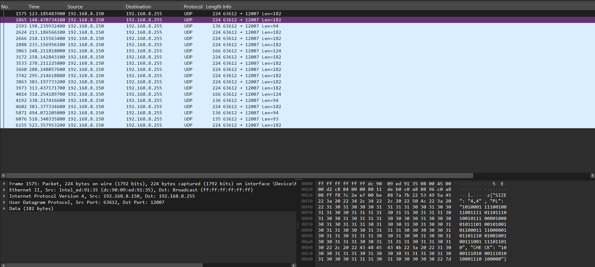
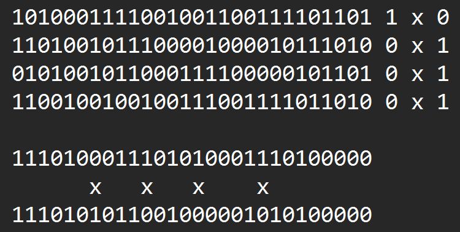
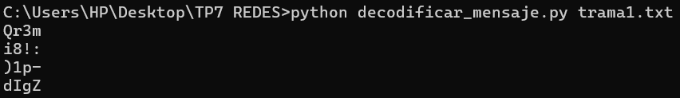
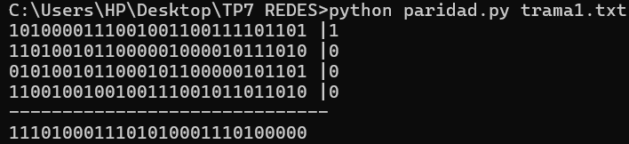
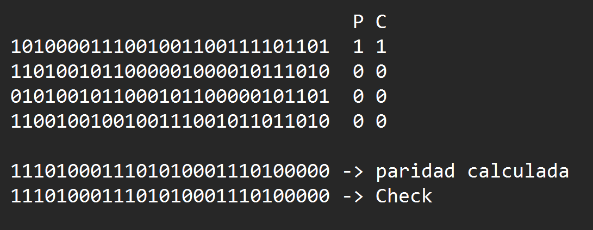
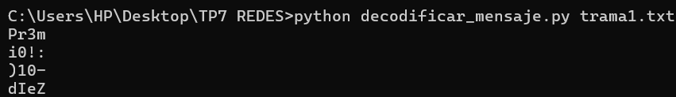

# Trabajo Práctico N°7: Captura, de-codificación y recuperación de datos

> Asignatura: Redes de Computadoras - Universidad Nacional de Córdoba (FCEFyN)
> 
> Integrantes (WAN-DIRECTION):
> * Baigorria, Ramiro Javier
> * Urrestarazu, Juan Ignacio
> * Mena, Franco Grabiel
> * Herrera, Mauricio Agustin
> * Ciruzzi, Martina
> * Montes, Franco Leonel
> * Valla Tello, Desiderio Jesus
 
> Profesor: Santiago Martin Henn
> * Santiago Martin Henn

## Configuraciones Generales
* **IP y Máscara:** 192.168.8.189/255.255.255.0
* **Broadcast (IP y MAC):** 
  * **IP de broadcast calculada:** `192.168.8.255`. 
  * **MAC de broadcast:** `ff:ff:ff:ff:ff:ff`. Verificado en la capa de enlace Ethernet II de la misma captura.

## Estructura y formato del mensaje
**Formato del mensaje:** Utiliza *JSON* caracterizado por estructurar la informacion en pares de clave-valor encerrados entre {}
* **Campos y representación:**
  * `"SIZE"`: Indica las dimensiones (filas y columnas) que tendrá la matriz de datos.
  * `"PL"` (Payload): Representa la carga útil, es decir, los unos y ceros que conforman los datos que llenarán la matriz.
  * `"CHECK"`: Contiene los bits de control (paridad bidimensional) enviados por el transmisor para detectar y ubicar los posibles errores.
* **Interpretación de los datos:** Para poder decodificar el mensaje se debe leer el tamaño de la matriz es decir filas x columnas, de esa forma solo se saca la cantiad de bits indicada del PL organizandolas secuencialmente hasta completar la matriz llenandola de a filas y luego las del check
* filas+columnas, teniendo en cuenta que los primero bits seran los de las filas, de arriba hacia abajo y los demas de las columnas, de izquierda a derecha.

## Tercer Trama
**Captura con Wireshark**

### Interpretacion de las dimesion de la matriz
**La matriz indicada era de "4,4" pero el PL era de **112 bits** y el 'CHECK' **32 bits** Si la matriz fuera de 4×4 bits (16 bits), no alcanzarían ni los datos ni los bits de control. 

La lectura consistente es que `SIZE` cuenta **caracteres de 7 bits**: una matriz de 4×4 caracteres, es decir, **4 filas × 28 columnas de bits**.

$$
\frac{112}{28} = 4
$$

La verificación con `CHECK` también cierra: 4 bits de paridad de filas + 28 de columnas = **32 bits**. Es la única forma de coincidan, ya que R × C = 112 y R + C = 32 solo tienen solución con 4 y 28.

### 3.3 Verificación de la paridad (síndrome)

Se calcularom las paridades y se compararon con las de `CHECK`:
* **Filas que fallan:** 1, 2, 3 y 4
* **Columnas que fallan:** 7, 11, 15 y 20

Este metodo de la paridad bidimensional es util para reconstruir un mensaje con un bit fallado; con mas de uno se podria saber que fallo mas no cual es para corregirlo.

## Decodificacion sin corregir
Como la paridad no ayudo para corregirlo, se decodifco tal cual para ver si el contexto ayudaba

Resultado: Qr3mi8!:)1p-dIgZ se puede intuir que el mensaje original era Pr3mi0!:)10-dIeZ

### Correccion 
Se modificaron los bits correspondientes a esta interpretacion y se recalculo su paridad:

### Comprobacion
Se comprobo que el check coincide con la nueva paridad

### Resultado

> **`Pr3mi0!:)10-dIeZ`**
