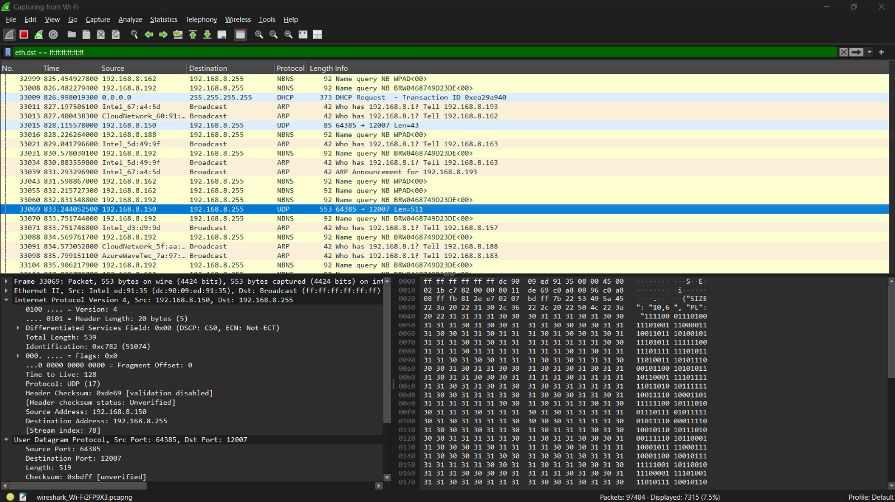
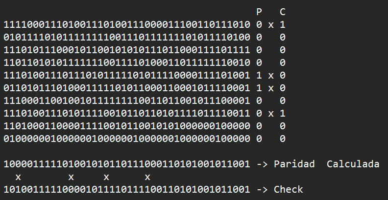
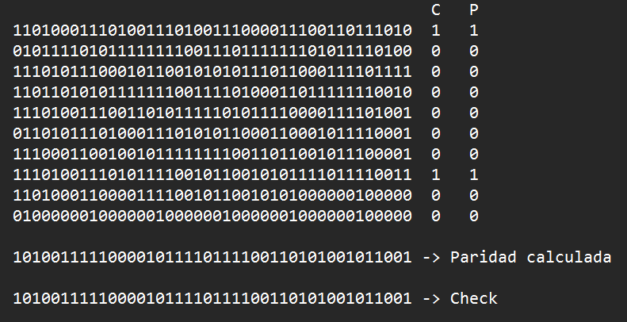

# Trabajo Práctico N°7: Captura, de-codificación y recuperación de datos

> Asignatura: Redes de Computadoras - Universidad Nacional de Córdoba (FCEFyN)
> 
> Integrantes (WAN-DIRECTION):
> * Baigorria, Ramiro Javier
> * Urrestarazu, Juan Ignacio
> * Mena, Franco Grabiel
> * Herrera, Mauricio Agustin
> * Ciruzzi, Martina
> * Montes, Franco Leonel
> * Valla Tello, Desiderio Jesus
 
> Profesor: Santiago Martin Henn
> * Santiago Martin Henn

## Configuraciones Generales
* **IP y Máscara:** 192.168.8.189/255.255.255.0
* **Broadcast (IP y MAC):** 
  * **IP de broadcast calculada:** `192.168.8.255`. 
  * **MAC de broadcast:** `ff:ff:ff:ff:ff:ff`. Verificado en la capa de enlace Ethernet II de la misma captura.

## Estructura y formato del mensaje
**Datos de origen y transmisión:**
 * **Protocolo de transporte:** UDP
 * **IP de origen:** 192.168.8.150
 * **Puerto de origen:** 64385

**Formato del mensaje:** Utiliza *JSON* caracterizado por estructurar la información en pares de clave-valor encerrados entre {}
* **Campos y representación:**
  * `"SIZE"`: Indica las dimensiones (filas y columnas) que tendrá la matriz de datos.
  * `"PL"` (Payload): Representa la carga útil, es decir, los unos y ceros que conforman los datos que llenarán la matriz.
  * `"CHECK"`: Contiene los bits de control (paridad bidimensional) enviados por el transmisor para detectar y ubicar los posibles errores.
* **Interpretación de los datos:** Para poder decodificar el mensaje se debe leer el tamaño de la matriz es decir filas x columnas, de esa forma solo se saca la cantidad de bits indicada del PL organizándolas secuencialmente hasta completar la matriz llenándola de a filas y luego las del check
* filas+columnas, teniendo en cuenta que los primeros bits serán los de las filas, de arriba hacia abajo y los demás de las columnas, de izquierda a derecha.

## Tercera Trama
**Captura con Wireshark**

### Interpretación de la dimensión de la matriz
*La matriz indicada era de "4,4" pero el PL era de **112 bits** y el 'CHECK' **32 bits** Si la matriz fuera de 4×4 bits (16 bits), no alcanzarían ni los datos ni los bits de control. 

La lectura consistente es que `SIZE` cuenta **caracteres de 7 bits**: una matriz de 4×4 caracteres, es decir, **4 filas × 28 columnas de bits**.

$$
\frac{112}{28} = 4 filas
$$

La verificación con `CHECK` también cierra: 4 bits de paridad de filas + 28 de columnas = **32 bits**. Es la única forma de que coincidan, ya que R × C = 112 y R + C = 32 solo tienen solución con 4 y 28.

### Verificación de la paridad (síndrome)

Se calcularon las paridades y se compararon con las de `CHECK`:
* **Filas que fallan:** 1, 2, 3 y 4
* **Columnas que fallan:** 7, 11, 15 y 20

Este método de la paridad bidimensional es útil para reconstruir un mensaje con un bit fallado; con más de uno se podría saber qué falló mas no cuál es para corregirlo.

## Decodificación sin corregir
Como la paridad no ayudó para corregirlo, se decodificó tal cual para ver si el contexto ayudaba

Resultado: Qr3mi8!:)1p-dIgZ se puede intuir que el mensaje original era Pr3mi0!:)10-dIeZ

### Corrección 
Se modificaron los bits correspondientes a esta interpretación y se recalculó su paridad:

### Comprobación
Se comprobó que el check coincide con la nueva paridad

### Resultado

> **`Pr3mi0!:)10-dIeZ`**

## Segunda Trama

**Captura en Wireshark**

### Interpretación de la dimensión de la matriz

Las dimensiones de la matriz son 10 filas por 6 columnas, con una `PL` de 420 bits y un `CHECK` de 52 bits. Teniendo estos datos y siguiendo la misma línea que para el 3er caso: 

$$
\frac{420 bits}{10 filas} = 42 bits/fila      
$$

entonces para 6 columnas, son : 

$$
\frac{42 bits}{6 columnas} = 7 bits/columna     
$$

y 42 + 10 = 52 que es la cantidad de bits del `CHECK`.

### Verificación de la paridad (síndrome)

Se armó la matriz, se calculó la paridad y se comparó con  el `CHECK`
* **Filas que fallan:** 1, 5, 6 y 8
* **Columnas que fallan:** 3, 12, 18 y 25

Lo que dio varios bits erróneos lo que no permite corregirlos usando la paridad. 

### Decodificación sin corrección

Decodificamos la trama para ver si el contexto ayudaba y obtuvimos:

xttps://youtube.com/shortw/WCi5h}1EqqI?featurm=share  

Un link a youtube, que a simple vista estaba mal en su formato, por lo que buscamos en la trama y corregimos:

* `x` -> `h`
* `w` -> `s`
* `}` -> `u`  una ID de youtube no puede llevar una llave
* `m` -> `e`

Luego de corregir x, w y m se buscó en la matriz el } y uno de sus bits coincidía en fila y columna con un error en la paridad por lo que se invirtió ese bit quedando en lugar de la llave una u

### Comprobación

Esta vez coincidiendo todos los bits.

### Resultado

Se decodificó y obtuvimos el link del short:

https://youtube.com/shorts/WCi5hu1EqqI?feature=share 

# Reflexiones e investigacion 

## Reflexión 1: 
Dos errores en filas y columnas distintas. Fallan 2 filas y 2 columnas, así que el error se detecta pero no se puede corregir con certeza. Ya que hay 2 formas de emparejar filas con columnas, y la paridad no distingue cuál es la real. Fue lo que pasó en ambas tramas del reto.

Otros casos:
* Dos errores en la misma fila: La paridad de esa fila cierra de nuevo, así que solo fallan 2 columnas. Se detecta, pero no se sabe en qué fila.
* Cuatro errores en las esquinas de un rectángulo:
  *Todas las paridades cierran entonces el error no se detecta.

 * Un bit de control dañado. Falla una sola fila o una sola columna, pero no ambas. No hay emparejamiento, los datos están bien, no hay que tocarlos. Un error en datos siempre hace fallar una fila y una columna y así lo emparejas, en cambio cuando es solo el bit de control, si corrigieras esa fila o columna para que coincida, estarías dañando un dato correcto.
## Reflexión 2:

El adivinar o corregir por contexto sirve cuando el mensaje tiene redundancia lingüística, como Hola mundo. Pero cuando cualquier símbolo es válido ya no es útil.
* Contraseña o número de cuenta: Cualquier símbolo es válido podrías ser cualquiera y nada te indicaría que es válido por lo que no se puede adivinar/
* Dirección web: en WCi5hu1EqqI (segunda trama), un carácter cualquiera podría ser otro, porque es un ID aleatorio. La u no se podría adivinar.

El código nos permite hacer una verificación objetiva. Dice qué filas y columnas no cierran ubicando el bit si es un único error. Con más errores nos avisa que algo falló y si podemos llegar a corregir algo por contexto podemos ver si el nuevo bit verifica.

## Reflexión 3: ¿Se pudo confirmar la corrección?
Sí, se pudo confirmar usando el CHECK luego de haber hecho las correcciones. Además de los textos resultantes eran coherentes Pr3mi0!:)10-dIeZ, y la URL de YouTube era válida.

## Reflexión 4:

El Hamming(7,4) es un método de corrección de errores, su funcionamiento consiste en agregar 3 bits de paridad a 4 bits de datos, es decir codificar una palabra de 7 bits. Las posiciones se numeran del 1 al 7:

* Posición 1 -> p1
* Posición 2 -> p2
* Posición 3 -> d1
* Posición 4 -> p4
* Posición 5 -> d2
* Posición 6 -> d3
* Posición 7 -> d4

Los bits de paridad ocupan las posiciones que son potencias de 2. Cada uno cubre las posiciones cuyo número en binario tiene encendido el bit correspondiente:

* p1 -> 1,3,5,7
* p2 -> 2,3,6,7
* p4 -> 4,5,6,7

Al recibir el mensaje, el receptor recalcula las tres paridades. Si alguna no coincide, los bits de control que fallan revelan la posición exacta del error mediante una suma directa.
Por ejemplo, si fallan las paridades p1 y p4, el error está en la posición 1+4 = 5.
El receptor invierte ese bit y el dato queda corregido.

Es superior a la paridad bidimensional del laboratorio por:
* Velocidad y tamaño de bloque: La paridad bidimensional requiere almacenar una matriz completa en memoria antes de poder cruzar filas y columnas para buscar errores. Hamming (7,4) corrige de forma continua en pequeños bloques de 7 bits.

* *Precisión matemática ante colisiones: En la paridad bidimensional, si hay 2 errores que caen la misma fila pero distinta columna, la paridad de la fila vuelve su valor de paridad (se anulan) y se pierde cual es el bit fallado. En cambio Hamming garantiza  la detección y corrección del bit corrupto.

*Aplicación práctica sobre la carga útil:*
Usaremos la carga útil del tercer reto Pr3mi0!:)10-dIeZ
La letra "P" en ASCII equivale a 10100000 (7bits).
Para transmitirla con Hamming (7,4), tomamos sus primeros 4 bits (1010):
* d1=1,d2=0.d3=1,d4=0
* p1 -> cubre p1,d1,d2,d4 -> son 1,0,0. Para ser par p1 = 1
* p2 -> cubre p2,d1,d3,d4 -> son 1,1,0. Ya es par, p2 = 0
* p4 -> cubre p4,d2,d3,d4 -> son 0,1,0. Para ser par. p4 = 1

El paquete listo para transmitir:
1 0 1 1 0 1 0